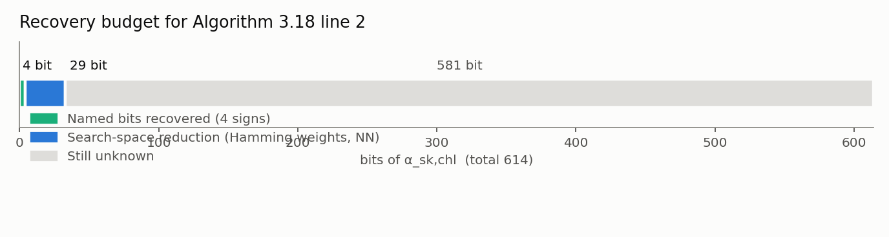
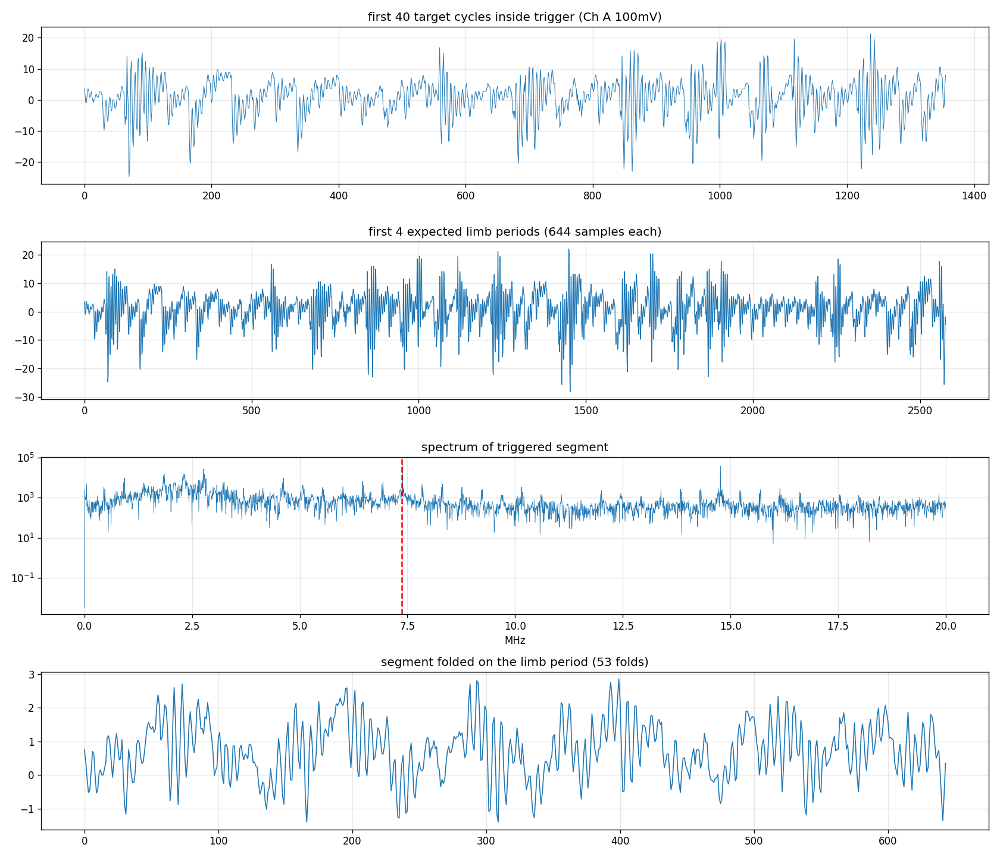
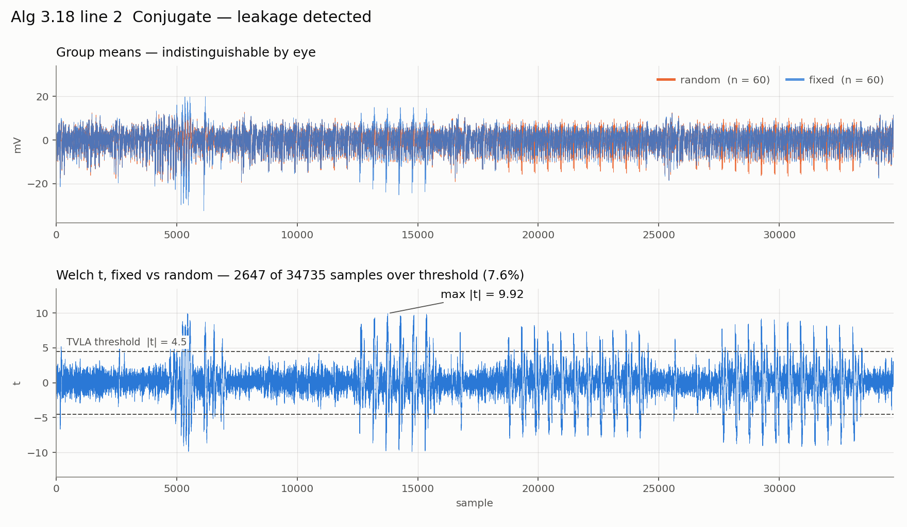
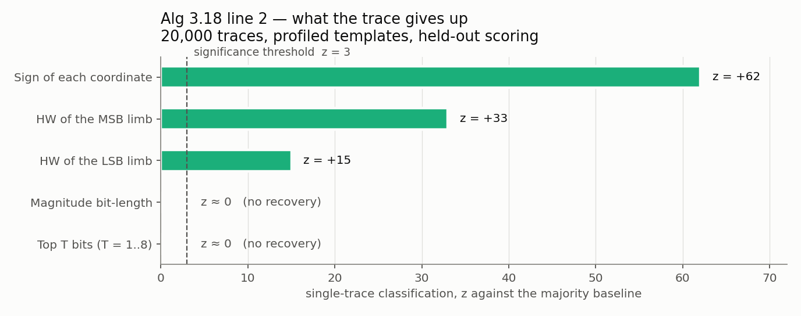

# Algorithm 3.18 line 2 `Conjugate(α_sk,chl)` 부채널 실험

SQIsign 2026 명세(`sqisign-20260901.pdf`)의 **Algorithm 3.18 SampleQuaternionResponse,
line 2**를 대상으로 한 측정·복구 실험 보고서.

```
Algorithm 3.18 SampleQuaternionResponse                                (명세 p.21)
 1: I'_sk,chl, α_sk,chl ← EquivalentCoprimeIdeal(I_sk,chl, 0, BitLenSkChall, prng_def)
 2: α_sk,chl ← Conjugate(α_sk,chl)                                    ← 측정 대상
 3: if GCD(IdealNorm(I_com), IdealNorm(I'_sk,chl)) ≠ 1 then raise
 5: q_rsp, α_rsp ← RandomBoundedElement(IdealMultiplication(I'_sk,chl, I_com), 2^(e_rsp−1), prng_res)
```

---

## 1. 결론 요약

| 항목 | 값 |
|---|---:|
| 추론 대상 (α_sk,chl) | **614 bit** |
| 지목해서 맞춘 비트 | **4 bit** (좌표별 부호, 정확도 100.0%) |
| **상위 비트(MSB)** | **0 bit** |
| 탐색공간 축소 (HW 정보) | 28.75 bit |
| 남은 탐색공간 | ≈ 581 bit |

**누설은 확실히 존재하지만(TVLA max\|t\| = 9.92), 상위 비트 복구는 되지 않는다.**
프로파일드 템플릿과 딥러닝 두 가지 독립적인 방법이 같은 결론을 낸다.



---

## 2. spec → 코드 대응

| 명세 | vendored 코드 | 내용 |
|---|---|---|
| Alg 3.18 line 2 | `protocol.c:37` | `quat_alg_conj(sk_chall_quat, sk_chall_quat)` |
| Alg 4.38 `Conjugate` | `algebra.c:168` | `ibz_copy`×2 (denom, coord0) + `ibz_neg`×3 (coord1,2,3) |
| 실제 산술 | `mp.c:469` | `ibz_neg()` — limb 단위 2의 보수 부정 루프 |

upstream: `the-sqisign.git` commit `f417ebd` (2026-09-21),
`scripts/gen_pqm4_sources.sh ref` 산출물 (p324_3 = 구 lvl1).

### 왜 측정 가능한가

2026 구현은 mini-gmp를 자체 `mp` 모듈로 교체했고 `ibz_t`가 **고정폭 2의 보수**가 되었다.

```c
struct ibz_t { int bitlen; digit_t limbs[IBZ_NLIMBS]; };   // p324_3, RADIX=32 → 60

void ibz_neg(ibz_t *neg, const ibz_t *a) {                 // mp.c:469
    int n = NUM_LIMBS(a->bitlen);
    digit_t carry = 1;
    for (int i = 0; i < n; i++) {
        ddigit_t t = (ddigit_t)~a->limbs[i] + carry;
        neg->limbs[i] = t;                                 // 모든 limb를 읽고 쓴다
        carry = t >> NUM_BITS_LIMB;
    }
    neg->bitlen = a->bitlen;
}
```

구 mini-gmp에서는 in-place `mpz_neg`가 `mpz_set`의 `r != x` 조기반환 때문에 부호비트만
뒤집혀 누설이 없었다. 신규 구현은 **in-place여도 limb 전체를 읽고 쓴다.**

실제 기계어 (빌드된 펌웨어 디스어셈블리):

```asm
; ---- 루프 몸통, limb 1개당 ----
800880c:  ldr.w r3, [r1, r6, lsl #2]   ; r3 = a->limbs[i]       ← 비밀 limb 로드
8001810:  subs  r7, r5, r3
8008812:  mvns  r3, r3                 ; r3 = ~limb
8008814:  adds  r3, r3, r5
8008816:  add.w r7, r7, #0xffffffff    ; r7 = ~limb + carry
800881a:  str.w r7, [r0, r6, lsl #2]   ; neg->limbs[i] = r7     ← 결과 저장
800881e:  adc.w r5, ip, ip
; ---- 루프 머리: 값이 아니라 카운터만 비교 ----
8008800:  cmp   r4, r3
8008806:  bgt.n 800880c
```

값에 의존하는 분기가 없고, 반복 횟수가 값이 아닌 **선언된 `bitlen`**에만 의존한다.

---

## 3. 복구 대상 크기

`ibz_t`는 `bitlen = 401` 고정이라 **항상 13칸(416 bit)을 순회**하지만, 실제 값은 작다.
2의 보수에서 남는 윗칸은 부호를 반복한다.

한 trace의 실제 예 (`b` 좌표, 235 bit, 양수):

```
limb 0~6   0x217194d1 ... 0xdf9d1f19    7칸 × 32 = 224 bit, 전부 비밀
limb 7     0x00000611                   남은 11 bit만 비밀, 윗 21 bit는 0
limb 8~12  0x00000000 ×5                양수라서 0만 반복. 비밀 0 bit
```

| 성분 | 실제 크기 (중앙값) | 범위 | 값 limb | 꽉 찬 limb | 부호 반복 limb |
|---|---:|---|---:|---:|---:|
| `a` (coord0) | 234 bit | 220–239 | 8 | 7 | 5 |
| `b` (coord1) | 234 bit | 217–239 | 8 | 7 | 5 |
| `c` (coord2) | 71 bit | 58–76 | 3 | 2 | 10 |
| `d` (coord3) | 71 bit | 56–76 | 3 | 2 | 10 |
| magnitude 합 | **610 bit** | | 22 | 18 | 30 |
| 부호 4개 | **4 bit** | | | | |
| `e` (denom) | 0 | 항상 2 | | | |
| **총계** | **614 bit** | | | | |

- `ibz_neg`가 도는 총 limb은 **52개**(4×13)지만, **30개는 순수 부호 확장**이라
  좌표당 1 bit, 합쳐서 **4 bit**만 담는다.
- `c`, `d`가 작은 이유: norm form이 `a² + b² + p(c² + d²)`이고 log₂p = 324이므로
  `c`, `d`는 `a`, `b`보다 약 2¹⁶²배 작다 (234 − 71 = 163 ≈ 324/2).

---

## 4. 측정 환경

| | |
|---|---|
| 타겟 | STM32F415 (Cortex-M4) on CW308 |
| 클럭 | **7.3846 MHz** (= 192 MHz / 26; 흔히 인용되는 7.3728 MHz가 아님) |
| 스코프 | PicoScope 3403D, Ch A 전력(AC, ±100 mV), Ch B 트리거(DC, ±5 V) |
| 샘플링 | 4 ns/sample (타겟 cycle당 ~34 샘플) |
| 트리거 | ChipWhisperer-Lite GPIO, `CONJ_TRIG_MODE=2`가 line 2를 감쌈 |

### 타이밍 (보드 DWT 카운터)

| 구간 | cycles | 비중 |
|---|---:|---:|
| Algorithm 3.18 전체 | 73–92 M (10–12.5 s) | 100% |
| line 1 `EquivalentCoprimeIdeal` | 43–50 M | ~53% |
| line 5 `RandomBoundedElement` | 41–42 M | ~46% |
| **line 2 `Conjugate`** | **1,121 (152 µs)** | **0.0013%** |

line 2 내부: `coord[0]` copy 144 cycle, `coord[1]/[2]/[3]` negate 각 247 cycle
→ **limb당 19.0 cycle** × 13 limb.

### 고속 경로

Alg 3.18 전체를 보드에서 돌리면 13.5 s/trace라 통계적으로 의미 있는 캠페인이 불가능하다.
측정 구간은 line 2뿐이므로, **호스트에서 실제 Alg 3.18을 돌려** α를 뽑고
(`conj_vector_host alphas`, 2000개에 7.4 s) 보드는 line 2만 실행한다.
실행 코드와 트리거 위치는 동일하고 주변 명령만 다르며, 캡처 시작 시
`alpha loaded exactly, Conjugate correct`로 검증한다. **238 ms/trace — 57배 빠르다.**

---

## 5. 트리거 정렬 검증


```
[0] trigger: 1 pulse, [2002, 36741)  width=34739 samples = 1024 cycles
    width vs DWT conjugate=1121 cycles -> ratio=0.91  OK
[1] trigger: 1 pulse, [2002, 36741)  width=34739 samples = 1024 cycles
trigger check: OK      triggered width sd=0.0      limbs per coordinate: [13]
```

펄스 시작이 pre-sample 위치에 정확히 붙고 **폭이 trace 간 sd = 0.0** 이다 — 정렬 작업이
필요 없다. DWT 대비 비율 0.91의 차이는 트리거 밖에 있지만 계측 구간 안에 있는
프로파일링 코드다.

### 신호 품질



Ch A를 ±100 mV로 낮추면 overflow 0, 스펙트럼에 **7.384 MHz 타겟 클럭과
14.8 / 29.5 / 36.9 / 44.3 MHz 고조파**가 뚜렷하고, limb 주기(644 샘플)로 53회 접은
평균에 재현되는 루프 시그니처가 나온다.

> **주의**: 기본값 ±500 mV로는 ADC를 5%만 써서 파형이 노이즈로만 보인다.
> Ch B도 3.3 V 트리거가 ±2 V 레인지를 넘겨 overflow한다.

---

## 6. 누설 검출 — TVLA



fixed 60 / random 60, 교차 수집:

```
fixed vs random : max|t| = 9.92 at sample 13757 (cycle ~406)
                  2647 of 34735 samples exceed 4.5 (7.62%)
fixed vs fixed  : max|t| = 4.23, 0 samples over threshold  OK
verdict: LEAKAGE DETECTED
```

대조군(fixed vs fixed)이 임계값 아래이므로 리그 드리프트가 아니라 데이터 의존 누설이다.
(그림에는 위 두 패널만 실었다 — 대조군 수치는 위 출력에 있다.)
t-trace는 균일하지 않고 **4개 밴드로 뭉치며**, 밴드 중심 간격이 ~250 cycle로 측정된
좌표당 비용 247 cycle과 일치한다 — `coord[0]` copy와 `coord[1..3]` negate에 대응한다.

---

## 7. limb별 SNR / 상관


random 200 trace, `CONJ_TRIG_MODE=2`. sign-extension limb 30개를 제외한
**정보 있는 limb 22개 전부가 노이즈 하한을 넘는다.**

| 좌표 | limb | \|corr(HW)\| | SNR | 위치 (cycle) |
|---|---|---|---|---|
| coord[0] (`a`, copy) | 0–6 | 0.46 – 0.80 | 0.45 – 3.69 | 121 → 143 |
| coord[1] (`b`, neg) | 0–6 | 0.57 – 0.72 | 0.90 – 2.65 | 262 → 358 |
| coord[2] (`c`, neg) | 0–1 | 0.40, 0.49 | 0.86, 0.92 | 524, 540 |
| coord[3] (`d`, neg) | 0–1 | 0.44, 0.50 | 0.64, 0.71 | 784, 802 |

**limb이 시간순으로 행진한다.** coord[1]의 limb 0→6이 샘플 8862 → 12106에 순서대로,
간격 ~540 샘플 ≈ 16 cycle로 찍힌다 (실측 19 cycle/limb과 일치). 이로써 TVLA 4밴드 ↔
좌표 대응이 추론이 아니라 실측으로 확정된다.

`coord[0]`은 negate가 아니라 `ibz_copy`(= `memmove`)인데도 샌다. newlib memmove에
`dst == src` 조기반환이 없어(디스어셈블리 `cmp r0,r1 / bls`) 52바이트를 그대로 복사한다.

---

## 8. 복구 시도

### 8.1 왜 CPA가 아니라 템플릿인가

α_sk,chl은 **서명마다 새로 뽑힌다** (line 1). 고정된 비밀을 여러 trace로 평균 내는
구조가 아니므로 CPA가 성립하지 않는다. trace를 많이 모으는 것은 **프로파일링** 용이고,
실제 공격은 해당 서명의 **trace 한 장**에서 복구해야 한다.

> 같은 보드에서 ground truth를 알고 프로파일링하므로 결과는 **상한**으로 읽어야 한다.

### 8.2 무엇이 새고 무엇이 안 새는가



프로파일링 16,000 / held-out 4,000, 단일 trace 공격:

| 대상 | 정확도 | 기준선 | z | 판정 |
|---|---|---|---|---|
| **부호 (좌표당 1 bit)** | **100.0%** | 50% | +62 | **완전 복구** |
| MSB limb의 HW | 26.6–28.6% | 11–14% | +23~33 | 복구 |
| LSB limb의 HW (대조) | 19.7–21.9% | 14% | +11~15 | 복구 |
| **magnitude bit-length** | 27.4% | 27.5% | **−0.0** | **기준선** |
| **상위 T비트 (T=1…8)** | 기준선과 동일 | | | **복구 안 됨** |

### 8.3 MSB 복구 실패


좌표별 상위 T비트를 클래스 레이블로 잡고
(`MSB_T(v) = floor(|v| / 2^(L−T))`, `L` = 해당 좌표의 magnitude 상한, 선행 0 포함),
프로파일링 split에서 템플릿을 학습해 held-out trace 한 장으로 분류했다.
**네 좌표 × T = 1…8 전부 다수 클래스 기준선과 동일하다.**

**왜 안 되는가 — 두 가지가 동시에 막는다.**

1. **magnitude bit-length가 복구되지 않는다** (z ≈ 0). MSB가 몇 번째 비트인지 모르면
   상위 비트를 지정할 수 없다. `bitlen`이 401로 고정이라 limb 개수가 값에 무관하고,
   magnitude는 상위 limb의 *값*만 바꾸므로 구조적 흔적을 남기지 않는다.
2. **HW는 비트에 대해 대칭이다.** `0x0F`와 `0xF0`은 HW가 같아 구분되지 않는다.
   상위 limb의 HW를 알아도 그 안의 비트 배치는 결정되지 않는다.

### 8.4 딥러닝 공격

템플릿과 LDA는 누설 모델(HW)을 가정한다. 신경망은 가정하지 않으므로 HW 외의 것이
있다면 찾아낸다. MLP, 학습 14,000 / 검증 2,000 / 테스트 4,000, **에폭은 검증 split으로
선택**(테스트셋으로 모델을 고르면 낙관 편향이 들어간다), **레이블 섞기 대조군** 포함.

| 대상 | 템플릿 | 신경망 |
|---|---:|---:|
| HW 정보량 (18 limb 합) | 10.35 bit | **28.75 bit** |
| 개별 비트 (32비트 limb 1개) | — | 0.044 bit |
| **상위 T비트 (T=1…8)** | 0 | **0** |

- **HW 추출은 2.8배 좋아진다** (천장 64 bit의 16% → 45%). 18 limb 중 15개에서
  1.5–2.2 bit씩 뽑는다.
- **MSB는 신경망으로도 0이다.** 네 좌표 × T=1…8 전부 z ≈ 0 이하, I = 0.000.

### 8.5 비트 수준 누설 — 존재하지만 무의미

| | 200 trace | 20,000 trace |
|---|---|---|
| 기준선 초과 비트 (LDA) | 0 / 576 | **481 / 576** |
| 평균 정확도 | — | 54.5% (기준선 50.7%) |
| **실제 정보량** | — | **~0.8 bit** (576비트 전부에서) |

200 trace에서 0/576이었던 것은 **검정력 부족**이었다(공격 trace 40개). 20,000 trace로
다시 재면 481/576이 기준선을 유의하게 넘고 신경망도 같은 것을 본다.

**다만 크기가 무의미하다.** 정확도 54.5%는 완벽히 보정돼도 비트당
`1 − H(0.545) = 0.0058 bit`, 576비트 전체로도 최대 3.3 bit다. 신경망 실측은 32비트
limb 하나당 **0.044 bit**다. 정확도만 보면 "복구됐다"고 오판하기 쉬우므로 **정보량으로
판정해야 한다.**

기전은 `ibz_neg`의 캐리 체인으로 보인다 — limb 밖으로 나가는 캐리는 그 limb이 0인지에
의존하는데, 이는 비트에 대해 대칭인 함수가 아니다.

---

## 9. 정보이론적 상한

```
limb당 추출 가능 최대 = H(HW of 32-bit word) = 3.547 bit
18개 깨끗한 limb × 3.547            =  64 bit   ← 천장
실측 (템플릿, 20,000 trace)         =  10 bit
실측 (신경망, 20,000 trace)         =  29 bit
복구 대상                           = 614 bit
```

trace를 늘려도 이 천장은 올라가지 않는다 — HW 추정 정확도만 올라간다.

### 처리 단위를 줄이면?

| 좌표 | 크기 | 32-bit limb | 상한 | 16-bit limb | 상한 |
|---|---:|---:|---:|---:|---:|
| `a` | 234 | 8 | 28.4 | 15 | 45.7 |
| `b` | 234 | 8 | 28.4 | 15 | 45.7 |
| `c` | 71 | 3 | 10.6 | 5 | 15.2 |
| `d` | 71 | 3 | 10.6 | 5 | 15.2 |
| 합계 | 610 | | **78.0** | | **121.9** (1.56배) |

`H(HW)`는 16비트에서 3.047, 32비트에서 3.547이라 limb당 정보는 줄지만 limb 개수가
거의 두 배라 총 정보량은 1.56배 늘어난다. 다만:

- `tutil.h`는 **RADIX 16을 지원하지 않는다** (`#error "Radix must be 32bit or 64 bit"`).
  upstream을 고쳐야 하고, 그러면 실제 SQIsign을 측정하는 것이 아니다.
- 측정 결과 32비트 워드는 **바이트 단위로 새지 않는다** (아래 §10). 하드웨어가 32비트
  덩어리로 움직이므로 소프트웨어만 16비트로 바꿔도 이득이 안 날 수 있다.
- MSB를 막는 두 장애물(bit-length 미복구, HW 대칭성)은 그대로다.

---

## 10. 누설 모델 판별

| 누설 모델 | 200 trace | 20,000 trace |
|---|---|---|
| `HW(word)` | **0.40 – 0.80**, 확실 | 확실 |
| 개별 비트 (binary LDA) | 0/576 초과 | 481/576 초과 (정보량 ~0.8 bit) |
| 바이트별 HW (`HW(word)` 편상관) | 72개 중 3개만 경계선 | — |
| 연속 limb 간 HD | 17개 중 2개 경계선 — 노이즈 | — |

바이트별 HW의 원상관이 `HW(word)`의 0.5배로 나오는 것은 `HW(word) = Σ HW(byte)`의
수학적 귀결이지 독립적인 바이트 누설이 아니다. 편상관으로 `HW(word)`를 제거하면
잔차가 귀무 밴드(~0.28)로 떨어진다.

---

## 11. 분석 시 주의할 함정

실험 과정에서 실제로 잘못된 결론을 낼 뻔한 지점들.

| 함정 | 증상 | 올바른 처리 |
|---|---|---|
| **sign-extension limb** | 52 limb 중 30개가 동일한 1-bit 레이블을 공유해 같은 샘플에서 \|corr\| 0.97로 나타남 | `classify_limb()`이 constant / sign / informative로 분류, sign은 순위에서 제외 |
| **max-over-samples 임계값** | `4/√N`은 **미리 정한 표본 하나**의 임계값. 34,734 샘플의 **최댓값**과 비교하면 순수 노이즈에서도 누설 판정 | `√(2 ln S)/√N` 사용 (N=200·S=34734에서 0.283이 아니라 **0.323**) |
| **정확도 vs 정보량** | 비트별 정확도 54.5%가 유의하게 기준선을 넘지만 정보량은 0.0058 bit/비트 | 정보량 `I = H(y) − H(y|trace)`로 판정 |
| **테스트셋으로 에폭 선택** | 60 에폭 중 held-out 최대를 고르면 50% 기준선이 ~52%로 부풀음 | 검증 split 분리 + 레이블 섞기 대조군 |
| **검정력 부족** | 공격 trace 40개로 "0/576"이라는 강한 음성 결론 | 20,000 trace로 재검정 → 481/576 |
| **`ibz_t` 비트 경계값** | hex 직렬화 왕복이 `bitlen`을 401 → 319로 조여 보드가 13 limb이 아닌 10 limb 구간을 실행 | 벡터 파일이 경계값을 싣고 `ibz_set_bound()`로 복원 |

---

## 12. 리그 설정 — 실제로 결과를 바꾼 것들

| 항목 | 증상 | 수정 |
|---|---|---|
| Ch A 레인지 ±500 mV | ADC를 5%만 사용, 파형이 노이즈로만 보임 | ±100 mV |
| Ch B 레인지 ±2 V | 3.3 V 트리거가 overflow | ±5 V |
| 타겟 클럭 상수 | 7.3728 MHz로 가정 | 실제 192/26 = **7.3846 MHz**, 스코프에서 읽음 |
| auto-trigger 5초 | line 1이 먼저 수 초간 돌아 엉뚱한 구간이 잡힘 | `auto_trigger_ms=0`으로 무한 대기 |
| `--skip-flash` 시 UART 깨짐 | 이전 펌웨어가 프로토콜 중간 상태로 남음 | nRST 펄스 + 재동기화 |
| PicoScope 버퍼 매번 재할당 | 수백 trace 후 캡처율 감쇠 | `__init__`에서 한 번만 할당 |
| **`ps3000aStop` 미호출** | 수백~수천 arm 후 트리거를 아예 안 받음 (437 ms/trace로 열화 후 실패) | 매 캡처 후 `Stop` → **100 ms/trace 안정** |
| SimpleSerial 예약 명령 | `'v'`, `'w'`, **`'y'`** 재등록 시 내장 핸들러에 가려져 명령 개수를 응답, 링크가 조용히 어긋남 | `'u'`, `'z'`, `'q'` 사용 |

---

## 13. 재현 방법

```bash
# 0. 호스트 도구 빌드 + KAT
./build_host_tool.sh
./conj_vector_host selftest 8          # upstream 불변식 검증

# 1. 실제 Alg 3.18로 α 생성 (20,000개 ≈ 74초)
./conj_vector_host alphas 20000 run1 > /tmp/alphas.txt

# 2. 펌웨어 (line 2에 트리거)
make clean PLATFORM=CW308_STM32F4
make PLATFORM=CW308_STM32F4 CONJ_TRIG_MODE=2

# 3. 트리거 정렬 검증  — 이게 통과해야 뒤가 의미 있다
~/.cwvenv/bin/python3 check_trigger.py --traces 3

# 4. 캡처 (238 ms/trace, 20,000개 ≈ 80분)
~/.cwvenv/bin/python3 capture_line2_pico.py --alphas /tmp/alphas.txt -n 20000

# 5. 분석
~/.cwvenv/bin/python3 msb_recover_line2.py     --npz /tmp/sqisign_line2.npz   # 상위 T비트
~/.cwvenv/bin/python3 recover_conj_template.py --npz /tmp/sqisign_line2.npz   # HW 정보량 + 비트별 LDA
~/.cwvenv/bin/python3 dl_recover_line2.py      --npz /tmp/sqisign_line2.npz   # 딥러닝
```

### 트리거 모드

| Mode | 구간 | 펄스 |
|---:|---|---:|
| 0 | Algorithm 3.18 전체 | 1 |
| 1 | line 1 `EquivalentCoprimeIdeal` | 1 |
| **2** | **line 2 `Conjugate` 전체 (기본)** | **1** |
| 3 | line 2, `ibz_neg` coord[1]/[2]/[3] 각각 | 3 |
| 4 | line 2, denom copy / coord[0] copy / coord[1..3] neg | 5 |
| 5 | line 5 `IdealMultiplication` | 1 |
| 6 | line 5 `RandomBoundedElement` | 1 |
| 7 | limb 순회 인공 probe (누설 상한용) | 3 |
| 8 | line 2, coord[1]의 **limb마다** 1펄스 | 13 |

---

## 14. 결론

**Algorithm 3.18 line 2는 MSB 기반 복원 알고리즘에 줄 입력이 없다.**

누설 자체는 강하다 — TVLA max\|t\| = 9.92, 정보 있는 limb 22개 전부가 노이즈 하한을
넘고, limb이 시간축에서 ~16 cycle 간격으로 분리되어 찍힌다. 그런데 새는 것이 본질적으로
`HW(32-bit word)` 하나이고, HW는 비트에 대해 대칭이며 magnitude bit-length가 복구되지
않아 MSB 위치조차 알 수 없다.

**614 bit 중 지목해서 맞춘 것은 부호 4 bit뿐이다.** 상위 비트는 템플릿과 딥러닝 두 가지
독립적인 방법에서 모두 0이다. 부호를 제약으로 쓸 수 있는 형태가 아니라면, 이 연산으로는
MSB 기반 실험이 성립하지 않는다.

### 파일

| 파일 | 내용 |
|---|---|
| `conj_core.{c,h}` | 계측된 Algorithm 3.18 (upstream `quat_response_element()`를 line 단위로 이식) |
| `simpleserial-sqisign-conj.c` | STM32F415 simpleserial 타겟 |
| `host/conj_vector_host.c` | 벡터 생성 + KAT + α 대량 생성 |
| `conj_rig.py` | PicoScope 3403D + CW-Lite 공용 리그 |
| `check_trigger.py` | 트리거 정렬 검증 |
| `capture_line2_pico.py` | line 2 고속 캡처 (α 주입) |
| `capture_conj_pico.py` | 전체 Alg 3.18 캡처 (TVLA/SNR용) |
| `analyze_conj_leakage.py` | TVLA + SNR + 상관 |
| `recover_conj_template.py` | 프로파일드 템플릿 복구 + 비트별 LDA |
| `msb_recover_line2.py` | 상위 T비트 복구 측정 |
| `dl_recover_line2.py` | 딥러닝 복구 (MLP) |
