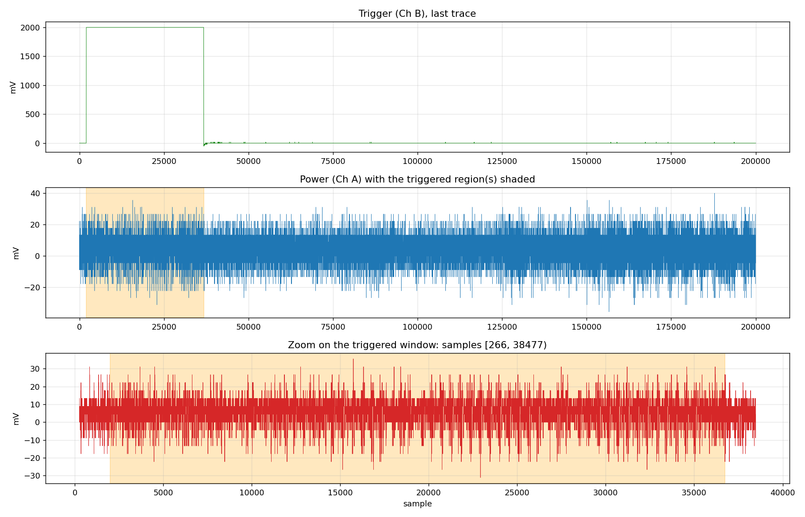
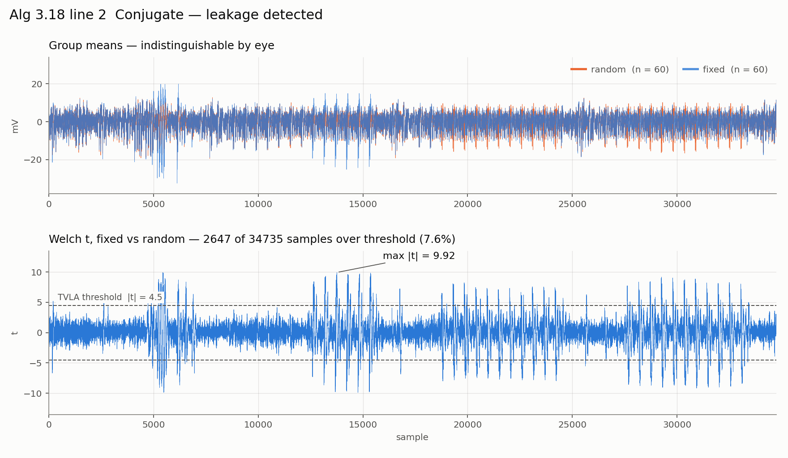
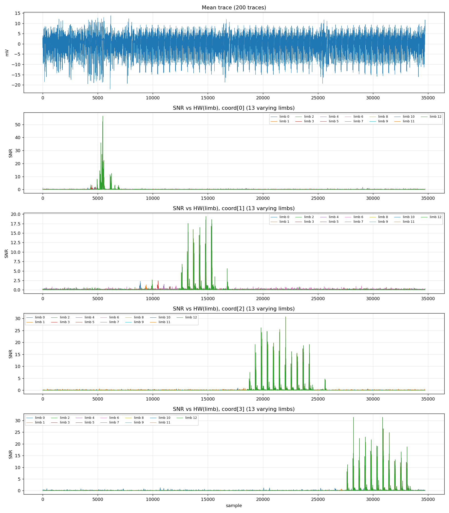
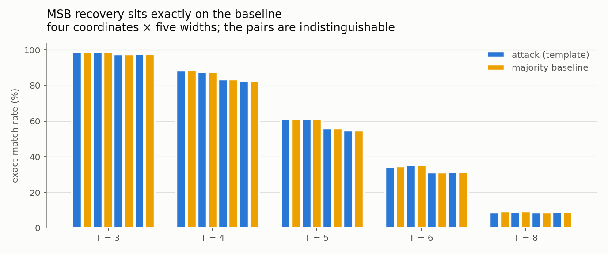

# Algorithm 3.18 line 2 `Conjugate(α_sk,chl)` side-channel experiment

Measurement and recovery report for **Algorithm 3.18 SampleQuaternionResponse,
line 2** of the SQIsign 2026 specification (`sqisign-20260901.pdf`).

```
Algorithm 3.18 SampleQuaternionResponse                                (spec p.21)
 1: I'_sk,chl, α_sk,chl <- EquivalentCoprimeIdeal(I_sk,chl, 0, BitLenSkChall, prng_def)
 2: α_sk,chl <- Conjugate(α_sk,chl)                                    <- the target
 3: if GCD(IdealNorm(I_com), IdealNorm(I'_sk,chl)) != 1 then raise
 5: q_rsp, α_rsp <- RandomBoundedElement(IdealMultiplication(I'_sk,chl, I_com), 2^(e_rsp-1), prng_res)
```

---

## 1. Summary

| Item | Value |
|---|---:|
| Secret to infer (α_sk,chl) | **614 bits** |
| Bits named and correct | **4 bits** (the per-coordinate signs, 100.0% accuracy) |
| **High-order bits (MSBs)** | **0 bits** |
| Search-space reduction (HW information) | 28.75 bits |
| Search space remaining | ≈ 581 bits |

**The leakage is unambiguously present (TVLA max\|t\| = 9.92), but the high-order
bits do not come out.** Profiled templates and deep learning, two independent
methods, reach the same conclusion.


---

## 2. Spec to code

| Spec | Vendored code | What it does |
|---|---|---|
| Alg 3.18 line 2 | `protocol.c:37` | `quat_alg_conj(sk_chall_quat, sk_chall_quat)` |
| Alg 4.38 `Conjugate` | `algebra.c:168` | `ibz_copy` x2 (denom, coord0) + `ibz_neg` x3 (coord1,2,3) |
| The actual arithmetic | `mp.c:469` | `ibz_neg()` — limb-wise two's-complement negation loop |

Upstream: `the-sqisign.git` commit `f417ebd` (2026-09-21), output of
`scripts/gen_pqm4_sources.sh ref` (p324_3 = the old lvl1).

### Why this is measurable at all

The 2026 implementation replaced mini-gmp with its own `mp` module, and `ibz_t`
became **fixed-width two's complement**.

```c
struct ibz_t { int bitlen; digit_t limbs[IBZ_NLIMBS]; };   // p324_3, RADIX=32 -> 60

void ibz_neg(ibz_t *neg, const ibz_t *a) {                 // mp.c:469
    int n = NUM_LIMBS(a->bitlen);
    digit_t carry = 1;
    for (int i = 0; i < n; i++) {
        ddigit_t t = (ddigit_t)~a->limbs[i] + carry;
        neg->limbs[i] = t;                                 // every limb is read and written
        carry = t >> NUM_BITS_LIMB;
    }
    neg->bitlen = a->bitlen;
}
```

Under the old mini-gmp, an in-place `mpz_neg` only flipped the sign bit because
`mpz_set` returns early when `r != x`, so there was nothing to leak. The new
implementation **reads and writes every limb even in place.**

The actual machine code (disassembly of the built firmware):

```asm
; ---- loop body, one limb per iteration ----
800880c:  ldr.w r3, [r1, r6, lsl #2]   ; r3 = a->limbs[i]       <- loads the secret limb
8001810:  subs  r7, r5, r3
8008812:  mvns  r3, r3                 ; r3 = ~limb
8008814:  adds  r3, r3, r5
8008816:  add.w r7, r7, #0xffffffff    ; r7 = ~limb + carry
800881a:  str.w r7, [r0, r6, lsl #2]   ; neg->limbs[i] = r7     <- stores the result
800881e:  adc.w r5, ip, ip
; ---- loop head: compares the counter, not the value ----
8008800:  cmp   r4, r3
8008806:  bgt.n 800880c
```

No value-dependent branch, and the iteration count depends only on the declared
`bitlen`, not on the value.

---

## 3. Size of the target

`ibz_t` has `bitlen = 401` fixed, so the loop **always walks 13 slots (416 bits)**,
but the actual values are smaller. In two's complement the leftover high slots just
repeat the sign.

A real example from one trace (coordinate `b`, 235 bits, positive):

```
limb 0-6   0x217194d1 ... 0xdf9d1f19    7 slots x 32 = 224 bits, all secret
limb 7     0x00000611                   only the low 11 bits are secret, top 21 are 0
limb 8-12  0x00000000 x5                positive, so just repeated zeros. 0 secret bits
```

| Component | Actual size (median) | Range | Value limbs | Full limbs | Sign-repeat limbs |
|---|---:|---|---:|---:|---:|
| `a` (coord0) | 234 bits | 220–239 | 8 | 7 | 5 |
| `b` (coord1) | 234 bits | 217–239 | 8 | 7 | 5 |
| `c` (coord2) | 71 bits | 58–76 | 3 | 2 | 10 |
| `d` (coord3) | 71 bits | 56–76 | 3 | 2 | 10 |
| magnitude total | **610 bits** | | 22 | 18 | 30 |
| 4 signs | **4 bits** | | | | |
| `e` (denom) | 0 | always 2 | | | |
| **Total** | **614 bits** | | | | |

- `ibz_neg` walks **52 limbs** in total (4 x 13), but **30 of them are pure sign
  extension** and carry 1 bit per coordinate — **4 bits** between them.
- `c` and `d` are small because the norm form is `a² + b² + p(c² + d²)` with
  log₂p = 324, so `c` and `d` are about 2¹⁶² times smaller than `a` and `b`
  (234 − 71 = 163 ≈ 324/2).

---

## 4. Measurement setup

| | |
|---|---|
| Target | STM32F415 (Cortex-M4) on CW308 |
| Clock | **7.3846 MHz** (= 192 MHz / 26; not the commonly quoted 7.3728 MHz) |
| Scope | PicoScope 3403D, Ch A power (AC, ±100 mV), Ch B trigger (DC, ±5 V) |
| Sampling | 4 ns/sample (~34 samples per target cycle) |
| Trigger | ChipWhisperer-Lite GPIO; `CONJ_TRIG_MODE=2` brackets line 2 |

### Timing (board DWT counter)

| Region | Cycles | Share |
|---|---:|---:|
| Whole Algorithm 3.18 | 73–92 M (10–12.5 s) | 100% |
| line 1 `EquivalentCoprimeIdeal` | 43–50 M | ~53% |
| line 5 `RandomBoundedElement` | 41–42 M | ~46% |
| **line 2 `Conjugate`** | **1,121 (152 µs)** | **0.0013%** |

Inside line 2: `coord[0]` copy 144 cycles, `coord[1]/[2]/[3]` negate 247 cycles each
→ **19.0 cycles per limb** x 13 limbs.

### Fast path

Running the whole of Alg 3.18 on the board costs 13.5 s/trace, which rules out a
statistically meaningful campaign. Only line 2 is measured, so the **host runs the
real Alg 3.18** to produce α (`conj_vector_host alphas`, 2000 of them in 7.4 s) and
the board executes line 2 alone. The executed code and the trigger placement are
identical and only the surrounding instructions differ; capture start verifies this
with `alpha loaded exactly, Conjugate correct`. **238 ms/trace — 57 times faster.**

---

## 5. Trigger alignment



```
[0] trigger: 1 pulse, [2002, 36741)  width=34739 samples = 1024 cycles
    width vs DWT conjugate=1121 cycles -> ratio=0.91  OK
[1] trigger: 1 pulse, [2002, 36741)  width=34739 samples = 1024 cycles
trigger check: OK      triggered width sd=0.0      limbs per coordinate: [13]
```

The pulse starts exactly at the pre-sample position and its width has **sd = 0.0
across traces** — no alignment work is needed. The 0.91 ratio against DWT is
profiling code that sits outside the trigger but inside the instrumented region.

### Signal quality


Dropping Ch A to ±100 mV gives zero overflow, a spectrum with the **7.384 MHz target
clock and its 14.8 / 29.5 / 36.9 / 44.3 MHz harmonics** clearly present, and a
reproducible loop signature in the average of 53 folds at the limb period (644
samples).

> **Caution**: at the ±500 mV default only 5% of the ADC range is used and the
> waveform looks like pure noise. Ch B also overflows, because a 3.3 V trigger
> exceeds the ±2 V range.

---

## 6. Leakage detection — TVLA



60 fixed / 60 random, interleaved:

```
fixed vs random : max|t| = 9.92 at sample 13757 (cycle ~406)
                  2647 of 34735 samples exceed 4.5 (7.62%)
fixed vs fixed  : max|t| = 4.23, 0 samples over threshold  OK
verdict: LEAKAGE DETECTED
```

The control (fixed vs fixed) stays below threshold, so this is data-dependent
leakage rather than rig drift. (The figure shows only the two panels above; the
control figure is in the output.) The t-trace is not uniform but **clusters into 4
bands**, with band centres about 250 cycles apart, matching the measured 247 cycles
per coordinate — they correspond to the `coord[0]` copy and the `coord[1..3]`
negations.

---

## 7. Per-limb SNR and correlation



200 random traces, `CONJ_TRIG_MODE=2`. Excluding the 30 sign-extension limbs, **all
22 informative limbs clear the noise floor.**

| Coordinate | Limbs | \|corr(HW)\| | SNR | Position (cycle) |
|---|---|---|---|---|
| coord[0] (`a`, copy) | 0–6 | 0.46 – 0.80 | 0.45 – 3.69 | 121 → 143 |
| coord[1] (`b`, neg) | 0–6 | 0.57 – 0.72 | 0.90 – 2.65 | 262 → 358 |
| coord[2] (`c`, neg) | 0–1 | 0.40, 0.49 | 0.86, 0.92 | 524, 540 |
| coord[3] (`d`, neg) | 0–1 | 0.44, 0.50 | 0.64, 0.71 | 784, 802 |

**The limbs march in time order.** coord[1]'s limbs 0→6 land in sequence at samples
8862 → 12106, about 540 samples ≈ 16 cycles apart (consistent with the measured
19 cycles/limb). This pins the TVLA bands to coordinates by measurement rather than
by inference.

`coord[0]` leaks even though it is an `ibz_copy` (`memmove`) and not a negation.
newlib's memmove has no `dst == src` early return (disassembly shows `cmp r0,r1 /
bls`), so it copies all 52 bytes regardless.

---

## 8. Recovery attempts

### 8.1 Why a template attack and not CPA

α_sk,chl is **redrawn for every signature** (line 1). There is no fixed secret to
average across traces, so CPA does not apply. Collecting many traces serves
**profiling**; the real attack has to recover from the **single trace** belonging to
the signature under attack.

> Profiling runs on the same board with ground truth known, so these results should
> be read as an **upper bound**.

### 8.2 What leaks and what does not


16,000 profiling / 4,000 held out, single-trace attack:

| Target | Accuracy | Baseline | z | Verdict |
|---|---|---|---|---|
| **Sign (1 bit per coordinate)** | **100.0%** | 50% | +62 | **fully recovered** |
| HW of the MSB limb | 26.6–28.6% | 11–14% | +23 to +33 | recovered |
| HW of the LSB limb (control) | 19.7–21.9% | 14% | +11 to +15 | recovered |
| **magnitude bit-length** | 27.4% | 27.5% | **−0.0** | **at baseline** |
| **Leading T bits (T = 1…8)** | same as baseline | | | **not recovered** |

### 8.3 MSB recovery fails



Taking the leading T bits of each coordinate as the class label
(`MSB_T(v) = floor(|v| / 2^(L−T))`, with `L` the magnitude bound for that coordinate,
leading zeros included), templates were trained on the profiling split and scored by
classifying a single held-out trace. **All four coordinates, for every T = 1…8, match
the majority-class baseline.**

**Why it fails — two things block it at once.**

1. **The magnitude bit-length is not recoverable** (z ≈ 0). Without knowing which bit
   is the MSB, no high-order bit can be named. `bitlen` is fixed at 401, so the limb
   count is independent of the value, and the magnitude only changes the *values* of
   the high limbs, leaving no structural trace.
2. **Hamming weight is symmetric in the bits.** `0x0F` and `0xF0` have the same
   weight and cannot be told apart. Knowing the high limb's HW does not determine the
   arrangement of bits inside it.

### 8.4 Deep-learning attack

Templates and LDA assume a leakage model (HW). A neural network assumes none, so if
anything beyond HW is present it should find it. MLP, 14,000 train / 2,000
validation / 4,000 test, **the epoch is chosen on the validation split** (choosing a
model on the test set introduces optimistic bias), with a **shuffled-label control**.

| Target | Templates | Neural network |
|---|---:|---:|
| HW information (sum over 18 limbs) | 10.35 bits | **28.75 bits** |
| A single bit (one 32-bit limb) | — | 0.044 bits |
| **Leading T bits (T = 1…8)** | 0 | **0** |

- **HW extraction improves 2.8x** (16% → 45% of the 64-bit ceiling). It extracts
  1.5–2.2 bits each from 15 of the 18 limbs.
- **MSBs are still 0 with a network.** All four coordinates, every T = 1…8, give
  z ≈ 0 or below and I = 0.000.

### 8.5 Bit-level leakage — present but meaningless

| | 200 traces | 20,000 traces |
|---|---|---|
| Bits beating baseline (LDA) | 0 / 576 | **481 / 576** |
| Mean accuracy | — | 54.5% (baseline 50.7%) |
| **Actual information** | — | **~0.8 bits** (over all 576 bits) |

The 0/576 at 200 traces was **insufficient statistical power** (40 attack traces).
Remeasured at 20,000 traces, 481/576 significantly beat the baseline, and the network
sees the same thing.

**The size, however, is meaningless.** 54.5% accuracy, even perfectly calibrated, is
`1 − H(0.545) = 0.0058 bits` per bit, or at most 3.3 bits over all 576. The measured
network figure is **0.044 bits** per 32-bit limb. Accuracy alone easily reads as
"recovered", so **the verdict has to be made on information.**

The mechanism appears to be the carry chain in `ibz_neg` — the carry leaving a limb
depends on whether that limb is zero, which is not a function symmetric in the bits.

---

## 9. Information-theoretic ceiling

```
maximum extractable per limb = H(HW of a 32-bit word) = 3.547 bits
18 clean limbs x 3.547               =  64 bits   <- the ceiling
measured (templates, 20,000 traces)  =  10 bits
measured (network, 20,000 traces)    =  29 bits
secret to recover                    = 614 bits
```

More traces do not raise this ceiling — they only improve the accuracy of the HW
estimate.

### What if the processing unit were smaller?

| Coordinate | Size | 32-bit limbs | Ceiling | 16-bit limbs | Ceiling |
|---|---:|---:|---:|---:|---:|
| `a` | 234 | 8 | 28.4 | 15 | 45.7 |
| `b` | 234 | 8 | 28.4 | 15 | 45.7 |
| `c` | 71 | 3 | 10.6 | 5 | 15.2 |
| `d` | 71 | 3 | 10.6 | 5 | 15.2 |
| Total | 610 | | **78.0** | | **121.9** (1.56x) |

`H(HW)` is 3.047 at 16 bits against 3.547 at 32, so per-limb information drops, but
the limb count nearly doubles and the total rises by 1.56x. However:

- `tutil.h` **does not support RADIX 16** (`#error "Radix must be 32bit or 64 bit"`).
  Patching upstream would mean no longer measuring real SQIsign.
- Measurement shows the 32-bit word **does not leak byte-wise** (section 10 below).
  The hardware moves 32-bit chunks, so changing only the software to 16 bits may
  yield nothing.
- The two obstacles blocking MSB recovery (unrecoverable bit-length, HW symmetry)
  are unchanged.

---

## 10. Discriminating the leakage model

| Leakage model | 200 traces | 20,000 traces |
|---|---|---|
| `HW(word)` | **0.40 – 0.80**, certain | certain |
| Individual bits (binary LDA) | 0/576 above | 481/576 above (~0.8 bits of information) |
| Per-byte HW (partial corr. against `HW(word)`) | only 3 of 72 marginal | — |
| HD between consecutive limbs | 2 of 17 marginal — noise | — |

Per-byte HW showing raw correlation at half of `HW(word)` is a mathematical
consequence of `HW(word) = Σ HW(byte)`, not independent byte leakage. Removing
`HW(word)` by partial correlation drops the residual into the null band (~0.28).

---

## 11. Analysis traps

Points in this work where a wrong conclusion was genuinely close.

| Trap | Symptom | Correct handling |
|---|---|---|
| **Sign-extension limbs** | 30 of 52 limbs share one identical 1-bit label and show \|corr\| 0.97 at the same sample | `classify_limb()` sorts limbs into constant / sign / informative and drops sign from the ranking |
| **Max-over-samples threshold** | `4/√N` is the threshold for **one pre-chosen sample**. Compared against the **maximum** over 34,734 samples it declares leakage even in pure noise | use `√(2 ln S)/√N` (at N=200, S=34734 that is **0.323**, not 0.283) |
| **Accuracy vs information** | per-bit accuracy of 54.5% significantly beats baseline, yet the information is 0.0058 bits/bit | judge on information, `I = H(y) − H(y\|trace)` |
| **Choosing the epoch on the test set** | taking the best held-out score over 60 epochs inflates a 50% baseline to ~52% | separate validation split plus a shuffled-label control |
| **Insufficient power** | a strong negative claim of "0/576" drawn from 40 attack traces | remeasure at 20,000 traces → 481/576 |
| **`ibz_t` bit bounds** | a hex serialisation round-trip tightened `bitlen` from 401 to 319, so the board executed a 10-limb region instead of 13 | the vector file carries the bound and `ibz_set_bound()` restores it |

---

## 12. Rig settings that actually changed results

| Item | Symptom | Fix |
|---|---|---|
| Ch A range ±500 mV | only 5% of the ADC used; waveform looked like pure noise | ±100 mV |
| Ch B range ±2 V | the 3.3 V trigger overflowed | ±5 V |
| Target clock constant | assumed 7.3728 MHz | actually 192/26 = **7.3846 MHz**, read from the scope |
| auto-trigger at 5 s | line 1 runs first for several seconds, so the wrong region was captured | `auto_trigger_ms=0` to wait indefinitely |
| UART desync with `--skip-flash` | the previous firmware was left mid-protocol | nRST pulse plus resynchronisation |
| PicoScope buffers reallocated per arm | capture rate decayed after a few hundred traces | allocate once in `__init__` |
| **`ps3000aStop` never called** | after a few hundred to a few thousand arms the trigger stopped firing entirely (degrading to 437 ms/trace first) | call `Stop` after every capture → **stable at 100 ms/trace** |
| SimpleSerial reserved commands | re-registering `'v'`, `'w'`, **`'y'`** is shadowed by built-in handlers that answer with the command count, so the link silently desynchronises | use `'u'`, `'z'`, `'q'` |

---

## 13. Reproducing

```bash
# 0. build the host tool and run the KAT
./build_host_tool.sh
./conj_vector_host selftest 8          # checks the upstream invariants

# 1. generate alpha with the real Alg 3.18 (20,000 of them ~ 74 s)
./conj_vector_host alphas 20000 run1 > /tmp/alphas.txt

# 2. firmware (trigger on line 2)
make clean PLATFORM=CW308_STM32F4
make PLATFORM=CW308_STM32F4 CONJ_TRIG_MODE=2

# 3. verify trigger alignment -- nothing after this means anything until it passes
~/.cwvenv/bin/python3 ../common/check_trigger.py --traces 3

# 4. capture (238 ms/trace, 20,000 traces ~ 80 min)
~/.cwvenv/bin/python3 capture_line2_pico.py --alphas /tmp/alphas.txt -n 20000

# 5. analysis
~/.cwvenv/bin/python3 ../common/msb_recover.py --npz /tmp/sqisign_line2.npz   # leading T bits
~/.cwvenv/bin/python3 ../common/recover_conj_template.py --npz /tmp/sqisign_line2.npz   # HW information + per-bit LDA
~/.cwvenv/bin/python3 ../common/dl_recover.py  --npz /tmp/sqisign_line2.npz   # deep learning
```

### Trigger modes

| Mode | Region | Pulses |
|---:|---|---:|
| 0 | whole Algorithm 3.18 | 1 |
| 1 | line 1 `EquivalentCoprimeIdeal` | 1 |
| **2** | **whole of line 2 `Conjugate` (default)** | **1** |
| 3 | line 2, `ibz_neg` on coord[1]/[2]/[3] separately | 3 |
| 4 | line 2, denom copy / coord[0] copy / coord[1..3] neg | 5 |
| 5 | line 5 `IdealMultiplication` | 1 |
| 6 | line 5 `RandomBoundedElement` | 1 |
| 7 | artificial limb-walk probe (for the leakage ceiling) | 3 |
| 8 | line 2, one pulse **per limb** of coord[1] | 13 |

---

## 14. Conclusion

**Algorithm 3.18 line 2 has nothing to give an MSB-based reconstruction algorithm.**

The leakage itself is strong — TVLA max\|t\| = 9.92, all 22 informative limbs clear
the noise floor, and the limbs separate in time about 16 cycles apart. But what
leaks is essentially one thing, `HW(32-bit word)`. Hamming weight is symmetric in
the bits, and the magnitude bit-length is not recoverable, so even the position of
the MSB is unknown.

**Of 614 bits, the only ones named correctly are the 4 signs.** The high-order bits
are zero under two independent methods, templates and deep learning. Unless the signs
can be used as a constraint in some other form, this operation does not support an
MSB-based experiment.

### Files

| File | Contents |
|---|---|
| `conj_core.{c,h}` | instrumented Algorithm 3.18 (upstream `quat_response_element()` ported line by line) |
| `simpleserial-sqisign-conj.c` | STM32F415 simpleserial target |
| `host/conj_vector_host.c` | vector generation, KAT, bulk α generation |
| `../common/conj_rig.py` | shared PicoScope 3403D + CW-Lite rig |
| `../common/check_trigger.py` | trigger alignment check |
| `capture_line2_pico.py` | fast line 2 capture (α injected) |
| `capture_conj_pico.py` | whole Alg 3.18 capture (for TVLA/SNR) |
| `../common/analyze_conj_leakage.py` | TVLA + SNR + correlation |
| `../common/recover_conj_template.py` | profiled template recovery + per-bit LDA |
| `../common/msb_recover.py` | leading-T-bit recovery measurement |
| `../common/dl_recover.py` | deep-learning recovery (MLP) |
