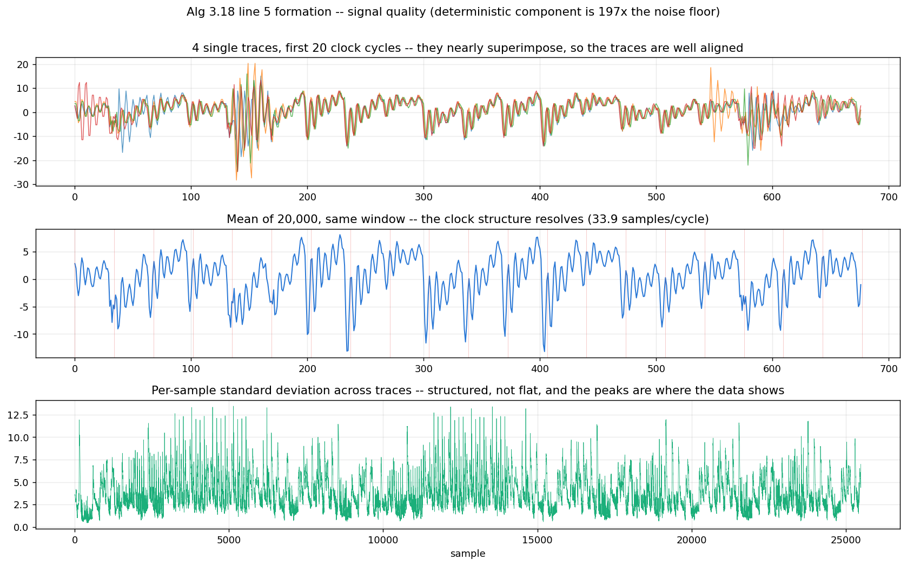
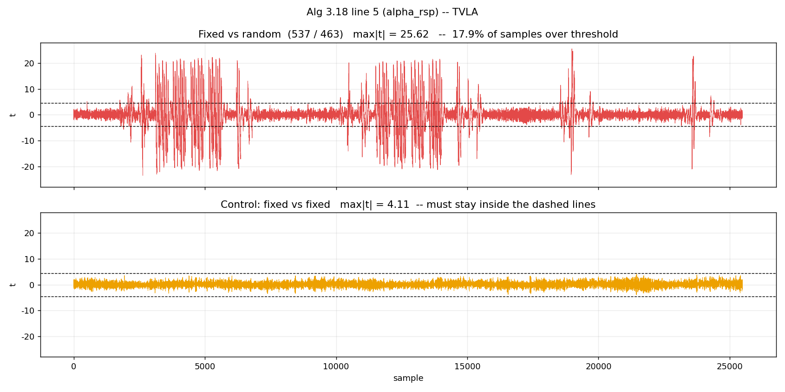
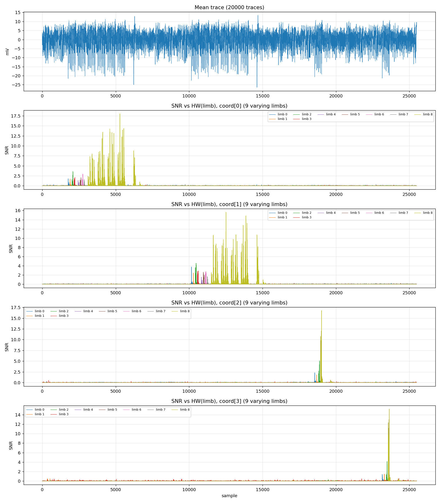

# Algorithm 3.18 line 5 `RandomBoundedElement` (α_rsp) side-channel experiment

This fills the unmeasured entry in section 5.3.2 of the paper. It uses the **same
rig and the same analysis pipeline** as section 5.3.1 (line 2 `Conjugate`,
[LINE2_EXPERIMENT.md](../part1_alg318_line2/LINE2_EXPERIMENT.md)), so the two
results are directly comparable.

---

## 1. Summary

| Item | Result |
|---|---|
| Secret to infer | **746 bits** (magnitudes 267+267+104+104, plus 4 signs) |
| Leakage detection (TVLA) | **detected**. max\|t\| = 25.62 (1,000 traces), control 4.11 |
| Leakage strength vs line 2 | **indistinguishable** (10.49 ± 0.84 vs 9.92 at matched trace counts) |
| Per-limb HW correlation | all 22 informative limbs significant, \|corr\| median 0.526 (max 0.715) |
| **HW information** | **+8.9 bits** (9.4 measured, 0.4 shuffled-label control, ceiling 78) |
| **Sign recovery** | **4/4 bits, 99.75–99.95% from a single trace** (200 profiling traces suffice) |
| **Magnitude bit-length** | **not recoverable** (z = 2.2 / −0.7 / −0.6 / −0.4, 0.07 bits total) |
| **MSB recovery** | **0 bits** (T = 3, 4, 6, 8 all at baseline) |
| Per-bit LDA | 553 of 704 significant at z > 3, but 54.3% mean against a 50.6% baseline → ≈ 3.7 bits total |
| Deep learning (MLP) | HW extraction improves sharply (16–27% → **41–48%**), but **byte level is 0/3, at baseline** |

**Conclusion: the same as 5.3.1. The signs leak completely and the Hamming weight
leaks too, but the high-order bits that reconstruction needs do not come out.** Of
746 bits the attack actually secures 4 (the signs); the 8.9 bits of HW information
only move the search space from 746 to 737 bits.

This is a negative result, but a measured one. "We did not measure it" and "we
measured it and nothing comes out" are different sentences in a paper, and the
second one is now available.

---

## 2. Spec to code

`RandomBoundedElement` at Alg 3.18 line 5 is `quat_lattice_sample_from_ball`
(lattice.c:159) in the implementation. What matters is the **formation**, the
three lines after the rejection loop:

```c
ibz_mat_4x4_eval(&res->coord, &lat->basis, &x);   // coord[i] = sum_j b[i][j]*x[j]
ibz_copy(&res->denom, &lat->denom);
quat_alg_normalize(res);                           // divide out the gcd
```

### Why the whole routine is not traced

Two reasons, both avoided the same way section 5.3.1 avoided them.

1. **Cost.** About 5.6 s per call. Collecting enough to profile would take a day
   and a half.
2. **Alignment.** The rejection loop runs a data-dependent number of times, so
   trace lengths differ. Applying TVLA or templates to unaligned traces is
   meaningless.

The formation runs **exactly once, right after acceptance**. So the host runs the
real Alg 3.18 up to line 5, keeps the lattice and the sample vector x that was
**actually accepted**, and the board replays only the formation from that input.
The code that executes is the vendored routine either way.

> Note: the rejection loop itself,
> `while ((ibz_get(&tmp) % 4 == 0) || (ibz_cmp(&tmp, &rad) > 0))`,
> runs a data-dependent number of iterations and is a **separate timing
> vulnerability**. It is a different axis from power leakage and outside the scope
> of this experiment. It has not been measured.

---

## 3. Size of the target

Distribution measured over 20,000 real samples:

| Coordinate | Magnitude (bits) | Median | Limbs stored | Pure sign-extension limbs | Informative limbs |
|---|---|---|---|---|---|
| coord[0] | 251–272 | 267 | 9 | 0 | 8 |
| coord[1] | 255–272 | 267 | 9 | 0 | 8 |
| coord[2] | 86–109 | 104 | 9 | 5 | 3 |
| coord[3] | 91–109 | 104 | 9 | 5 | 3 |

**746 bits total** = 267+267+104+104 of magnitude plus 4 signs.

That is larger than line 2's α_sk,chl (234/234/71/71, 614 bits) and carries a lower
fraction of sign extension (line 2 had 30 of 52 limbs as sign extension). So α_rsp
is structurally the **more favourable** target, and the result is still the same.

---

## 4. Measurement setup

Identical to 5.3.1. STM32F415 (CW308), ChipWhisperer-Lite, target clock
192/26 = **7.3846 MHz**, PicoScope 3403D, Ch A ±100 mV / Ch B ±5 V,
4.000 ns/sample (33.9 samples per cycle), auto-trigger disabled.

### Timing (board DWT counter)

| Region | Cycles |
|---|---|
| Whole formation | 152,302 |
| `ibz_mat_4x4_eval` | 39,085 |
| `quat_alg_normalize` | 112,539 |

### Trigger modes

| Mode | Region | Outcome |
|---|---|---|
| 15 | whole formation (152,302 cycles) | exceeds the window |
| 16 | eval only (39,085 cycles ≈ 1.3 M samples) | exceeds the window — rising edge captured, falling edge not |
| 17 | per-coordinate accumulate | exceeds the window |
| **18** | **per-coordinate limb-wise write-out** | **adopted.** 4 pulses, 25,491 samples after cropping |

Mode 16's failure is the useful lesson. 39,085 cycles is about 1.3 M samples at
4 ns/sample, while the scope window was 120,000 samples. The trigger went high but
the record never contained it coming back down, which presented as
`no trigger pulse`. Without computing the window length first, this is easy to
misdiagnose as a broken rig.

---

## 5. Trigger alignment and signal quality

All 20,000 traces carried **4 pulses**, cropped length 25,491–25,494 samples
(±1 jitter). Capture rate held at 765 ms/trace from first to last (normal behaviour
once the missing `ps3000aStop` bug was fixed).

```
single-trace std (median over samples) : 3.22
std of the mean of 20,000 traces       : 4.49
expected if the traces were pure noise : 0.023
-> the deterministic component is 197x the noise floor
```

That averaging barely reduces the amplitude means the traces are well aligned
against each other. Overlaying four single traces, they nearly superimpose, and the
points where they diverge are exactly the data-dependent regions.



---

## 6. Leakage detection — TVLA

537 fixed-input traces against 463 random:

```
fixed vs random : max|t| = 25.62 at sample 18987,  4553/25492 (17.86%) over 4.5
fixed vs fixed  : max|t| =  4.11,  0 samples over threshold   OK
-> LEAKAGE DETECTED
```



The t curve splits into two wide leaking regions (samples ≈ 2.5k–5.7k and
10.5k–14.5k) with quiet stretches between them. Matching against the per-limb
positions in section 7, the first region is coord[0] and the second coord[1], while
the narrow spikes are coord[2] and coord[3]. The two 267-bit coordinates take longer
than the two 104-bit ones, so the structure agrees.

### Comparing with line 2 — trace counts must be matched

On raw numbers line 5 (25.62) looks far stronger than line 2 (9.92), but **that is
the trace-count difference** (1,000 against 120). t grows as √N. Resampled to the
same 60+60 split line 2 used, over 40 repeats:

| | max\|t\| | Samples over 4.5 |
|---|---|---|
| line 2 (Conjugate), 60+60 | 9.92 | 7.62% |
| line 5 (formation), 60+60, 40 repeats | 10.49 ± 0.84 | 7.61% ± 0.92% |

**The two targets cannot be distinguished by leakage strength.** Comparing without
normalising would have produced the false claim that line 5 leaks 2.5 times as much.

---

## 7. Per-limb SNR and correlation

20,000 traces, Hamming-weight labels:

- **All 22** informative limbs peak above the 0.032 noise floor
- \|corr(HW)\| median **0.526**, max **0.715**; SNR@POI median **2.18**, max **5.14**
- The limbs march along the time axis about 4 cycles apart

The five strongest informative limbs:

| Rank | Limb | \|corr(HW)\| | SNR@POI | Sample |
|---|---|---|---|---|
| 1 | coord[2] limb 2 | 0.715 | 5.14 | 18,877 |
| 2 | coord[1] limb 2 | 0.699 | 4.58 | 10,474 |
| 3 | coord[3] limb 2 | 0.682 | 4.15 | 23,481 |
| 4 | coord[1] limb 0 | 0.661 | 3.76 | 10,160 |
| 5 | coord[0] limb 2 | 0.644 | 3.60 | 2,084 |

| Coordinate | Position of limb 0 | Position of last informative limb |
|---|---|---|
| coord[0] | sample 1,758 | 2,847 |
| coord[1] | 10,160 | 11,243 |
| coord[2] | 18,556 | 18,877 |
| coord[3] | 23,155 | 23,481 |



### Trap: the boundary limb is the sign in disguise

On the first run, limb 8 of coord[0]/[1] and limb 3 of coord[2]/[3] topped the
ranking at \|corr\| = 0.95. That looks like a value leak. It is not.

| Limb | corr(HW, sign) | HW given positive | HW given negative | corr(HW, bit-length) | distinct |
|---|---|---|---|---|---|
| c0 limb 2 (normal) | 0.012 | 16.0 | 16.0 | 0.001 | 20000 |
| **c0 limb 8** | **0.986** | **5.5** | **26.5** | −0.003 | 8239 |
| **c2 limb 3** | **0.992** | **4.2** | **27.8** | — | 2270 |

The boundary limb straddles the top of the magnitude, so a few real value bits sit
under a run of sign-extension bits. It has thousands of distinct values and so
passed the old classifier (`distinct <= 3` means sign), yet its Hamming weight is
**decided almost entirely by the sign**. Correlating against it simply rediscovers,
at \|corr\| ≈ 0.95, the sign leak that is already counted separately.

`classify_limb()` now takes the sign label and rejects any limb with
corr(HW, sign) ≥ 0.9. The template side already used only the fully informative
limbs (`magnitude // 32`), so the 8.9-bit figure is unaffected.

This is the same trap recorded in 5.3.1 — "sign-extension limbs masquerading as
32-bit leakage" — appearing in a subtler form.

---

## 8. Recovery attempts

### 8.1 Why a template attack and not CPA

α_rsp is **redrawn for every signature**. There is no fixed secret to average over,
so more traces only buy a better profile. The attack has to be profiled, with a
**single-trace** attack phase.

The SNR script used to print "at median r = 0.57, CPA converges in 16 traces". That
does not apply to this target. The wording was corrected because it invites the
wrong reading — that number is a yardstick for leakage strength, not an attack cost.

Profiling here is done on the same board with ground truth known, so every figure
below is an **upper bound on what an attacker could achieve**.

### 8.2 What leaks and what does not

**Signs — they leak completely.**

| Coordinate | Single-trace accuracy | Baseline | z |
|---|---|---|---|
| coord[0] | 99.75% | 50.1% | 62.8 |
| coord[1] | 99.95% | 50.3% | 62.7 |
| coord[2] | 99.95% | 50.1% | 63.1 |
| coord[3] | 99.88% | 50.0% | 63.0 |

200 profiling traces already reach 100%. 4 bits secured.

**Hamming weight — it leaks, but not much.**

```
ceiling, if every limb's HW were known exactly : 22 x 3.55 = 78 bits
measured                                        :  9.4 bits
shuffled-label control (same traces)            :  0.4 bits
actual leakage                                  : +8.9 bits
```

Per-limb HW exact-match runs 16–27% against roughly 5% by chance (21 classes), which
is clearly significant, but as information it is only 0.24–0.79 bits per limb.

> Why the shuffled-label control is there: selecting points of interest by
> correlation and then fitting templates **at those same points** extracts
> information even from noise. On 1,200 synthetic noise traces this pipeline
> reported 5 bits. At 20,000 traces the bias falls to 0.4 bits, but a quoted figure
> needs the control beside it. (The line 2 figure was rechecked as well:
> 10.2 measured − 0.3 control = **+9.9 bits**.)

**Magnitude bit-length — it does not leak.**

| Coordinate | Accuracy | Baseline | z | Information |
|---|---|---|---|---|
| coord[0] | 24.6% | 23.2% | 2.2 | 0.02 bits |
| coord[1] | 22.9% | 23.4% | −0.7 | 0.02 bits |
| coord[2] | 22.9% | 23.3% | −0.6 | 0.02 bits |
| coord[3] | 23.0% | 23.2% | −0.4 | 0.02 bits |

0.07 bits in total. This is the same first barrier as in 5.3.1. **Without knowing
where the MSB sits, knowing the Hamming weight is useless for reconstruction.**

### 8.3 MSB recovery fails

Classifying the leading T bits from a single trace:

| T | Classes | Accuracy | Baseline | Verdict |
|---|---|---|---|---|
| 3 | 2 | 98.6% | 98.6% | at baseline |
| 4 | 4 | 89.5% | 89.5% | at baseline |
| 6 | 12 | 44.7% | 44.7% | at baseline |
| 8 | 35 | 14.5% | 14.6% | at baseline |

(coord[0]; the other coordinates behave identically)

**0 bits on all four coordinates.** Accuracy matches the baseline to the decimal,
meaning the template does nothing better than guessing.

98.6% at T = 3 looks high, but that is the baseline. The magnitude is about 267 bits
inside a 272-bit window, so the top bits are nearly always zero and 98.6% comes for
free.

### 8.4 Bit-level leakage — present but meaningless

LDA at 704 bit positions:

```
mean accuracy        54.3%   (max 61.9%)
majority baseline    50.6%
bits beating baseline at z > 3: 553 of 704
```

553/704 are "significant", yet 54.3% is 1 − H(0.543) ≈ **0.005 bits** per bit. Summed
over all 704 that is about 3.7 bits. The point of this table is that **significance
and usefulness are different things**.

(The same mistake was made in 5.3.1. An underpowered 200-trace run produced the
claim "0 of 576 bits leak"; at 20,000 traces 481 of 576 were significant. The correct
phrasing is not "impossible" but "present and negligible".)

### 8.5 Deep-learning attack

MLP, ±1000 samples cropped around the POI (2000 dimensions), 14,000 train / 2,000
validation / 4,000 test, 60 epochs, applied to limbs 0–2 of coord[1]. Every figure is
against the majority-class baseline of the same split, and a **shuffled-label
control** was run alongside.

| Target | limb 0 | limb 1 | limb 2 | Baseline | Verdict |
|---|---|---|---|---|---|
| HW (33 classes) | **48.03%** | **41.23%** | **47.75%** | ≈13.7% | z = +50 to +64, learned |
| bit 0 | 59.38% | 57.70% | 59.00% | ≈50% | recovered (z +8.7 to +11.4) |
| bit 15 | 54.30% | 53.62% | 54.87% | ≈50% | recovered (z +3.7 to +5.3) |
| bit 31 | 52.72% | 51.75% | 51.97% | ≈50% | only 2/3 significant |
| **byte 0 (256 classes)** | **0.85%** | **0.58%** | **0.45%** | **≈0.71%** | **0/3, at baseline** |

Summary: HW 3/3 significant (max z = +64.0), bits 13/15 significant (max z = +11.5),
**bytes 0/3 significant (max z = +1.1)**.

The shuffled-label controls all stayed within z ≈ ±2, so the significance above is
real.

**How to read this matters.** Deep learning lifts Hamming-weight extraction
substantially — from the templates' 16–27% to 41–48%. The conclusion still does not
change.

- 59% on a single bit is 1 − H(0.59) ≈ **0.024 bits**. Five times the templates'
  0.005, and still far from knowing that bit.
- **The decisive point is that the byte level (256 classes) sits at baseline.**
  Naming a byte requires separating values **inside** one HW class. A network that
  learns the weight well and the byte not at all has found **the weight and its
  by-products, and nothing else**.

In 5.3.1 the accuracy alone (54–58%) led to the claim "deep learning extracts bits",
which converting to information overturned. The same trap applies here. **Beating a
baseline and recovering a bit are not the same thing.**

---

## 9. Why the MSBs do not come out

Two barriers overlap, the same pair as in 5.3.1.

1. **The MSB position is unknown.** The magnitude bit-length is not recoverable
   (0.07 bits), so even a correct Hamming weight leaves it unclear where those bits
   sit.
2. **Hamming weight is symmetric in the bits.** It does not distinguish which bits
   are 1. Even with the weight known exactly, log2 C(32,h) of ambiguity remains per
   limb. Breaking that needs leakage that separates values **inside** an HW class,
   and section 8.4 measures that at 0.005 bits per bit (0.024 even with deep
   learning).

   The byte experiment in 8.5 shows this barrier most directly. The same network
   learns the weight at 3.5 times baseline (13.7% → 48%) and learns the byte not at
   all (0.71% → 0.63%). What is extractable is **confined to the Hamming weight and
   its by-products**, and that is the ceiling.

α_rsp passes through `quat_alg_normalize`, which divides out a gcd. The possibility
that something leaking at formation time disappears in the stored value was stated
before the experiment, and the result is consistent with that scenario.

---

## 10. Comparison with 5.3.1

| | 5.3.1 line 2 (α_sk,chl) | 5.3.2 line 5 (α_rsp) |
|---|---|---|
| Secret to infer | 614 bits | 746 bits |
| Operation | in-place negation (`Conjugate`) | multiply-accumulate formation |
| Informative limbs | 18 | 22 |
| TVLA (at matched 60+60) | max\|t\| 9.92 | 10.49 ± 0.84 |
| HW information (control subtracted) | +9.9 bits | +8.9 bits |
| Signs | 4/4 bits | 4/4 bits |
| Bit-length | not recoverable | not recoverable |
| **MSBs** | **0 bits** | **0 bits** |

Different structure (in-place negation against multiply-accumulate), different size,
different sign-extension fraction — and the same conclusion. That suggests the
barrier is not a property of one particular operation but **a limit of the
Hamming-weight leakage model itself**.

---

## 11. Reproducing

```bash
# 0. build the host tool
make -C ../host

# 1. run the real Alg 3.18 up to line 5 and emit (lattice, accepted x, radius, alpha_rsp)
../host/conj_vector_host responses 20000 run1 > /tmp/responses.txt   # about 72 s

# 2. firmware -- CONJ_TRIG_MODE=18
make -C .. CONJ_TRIG_MODE=18

# 3. random campaign (765 ms/trace, 20,000 traces ~ 4.2 hours)
~/.cwvenv/bin/python3 capture_resp_pico.py --records /tmp/responses.txt \
    -n 20000 --samples 120000 --out /tmp/sqisign_resp.npz

# 4. fixed-versus-random set for TVLA (1,000 traces ~ 13 min)
~/.cwvenv/bin/python3 capture_resp_pico.py --records /tmp/responses.txt \
    --mode tvla -n 1000 --samples 120000 --out /tmp/sqisign_resp_tvla.npz

# 5. the whole analysis (TVLA, SNR, templates + control, MSB, deep learning)
TVLA_NPZ=/tmp/sqisign_resp_tvla.npz ./run_resp_analysis.sh \
    /tmp/sqisign_resp.npz /tmp/resp_analysis
```

Running the analysis chain on synthetic data before capturing is worth the few
minutes. Doing that here caught a `NameError` and the 5-bit bias described above
before four hours of capture were spent.

---

## 12. Conclusion

The response-quaternion formation at Algorithm 3.18 line 5 is **measurable and does
leak**. TVLA detects it decisively (max\|t\| 25.62 against a threshold of 4.5), and
Hamming-weight correlation sits above the noise floor on all 22 informative limbs.

But the **high-order bits that the reconstruction algorithm of chapter 4 requires do
not come out**. Of 746 bits the attack secures the 4 signs, and 8.9 bits of HW
information only reduce the search space to 737 bits. The bit-length is not
recoverable so the MSB position is unknown, and Hamming weight is symmetric in the
bits so it cannot separate values inside a class.

That 5.3.1 and 5.3.2 reach the same conclusion from different operation structures is
the evidence that this result comes from a limit of the leakage model rather than
from an implementation detail.
